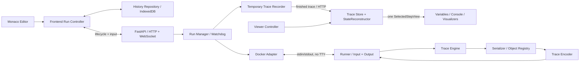
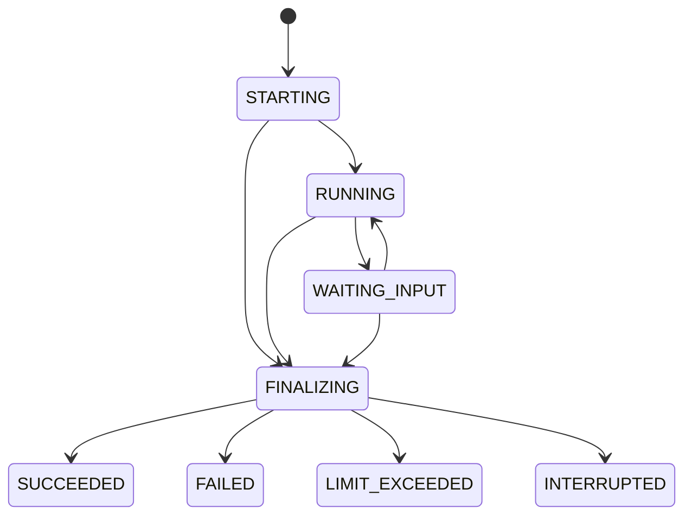

# CodeTrace Architecture Specification v1.0

Дата: 5 октября 2026 года. Статус: нормативная спецификация реализации первой версии.

Документ описывает архитектуру первой версии CodeTrace. Он фиксирует компоненты, форматы данных, lifecycle, ограничения и критерии готовности. Слова «должен», «запрещено» и «только» обозначают обязательные требования. Значения конфигурации ниже являются утверждёнными начальными значениями, а не результатами уже выполненных измерений.

CodeTrace работает локально. Архивирование трасс, серверная БД, удалённое исполнение и realtime debugging не входят в первую версию.

## 1 Назначение и границы

CodeTrace — локальное веб-приложение для просмотра записанного выполнения учебных Python-программ. Python выполняется один раз; переходы по готовой трассе не взаимодействуют с Runner. Realtime debugger отсутствует.

Поддерживаются int, float, bool, str, None, условия, циклы, обычные функции, рекурсия, list, tuple, dict, set, collections.deque и простые пользовательские классы с обычными атрибутами. Комплексные числа, bytes и остальные типы не входят в обязательную визуализацию.

Официально не поддерживаются generators/yield, async/await, потоки, подпроцессы, пользовательские exec/eval/compile, внешние packages, вмешательство в tracing, сложные descriptors/properties и нестандартный доступ к объектам. GC, weakref, __del__ и время освобождения объектов не входят в гарантии эквивалентности обычному запуску.

Разрешённые импорты v1: math и collections; от collections гарантированно поддерживается только deque. Импорт другого модуля завершается диагностикой UNSUPPORTED_FEATURE. Runner использует ограничивающую обёртку импорта; это граница поддерживаемых возможностей, а не самостоятельная защита хоста.

AST-проверка внутри контейнера отклоняет yield, async-конструкции и прямые обращения к запрещённым exec/eval/compile. Она не является попыткой доказать безопасность произвольного Python. Остальные неподдерживаемые формы не получают гарантий правильной трассы; сложные объекты отображаются как opaque. Запуск не требует анализа алгоритма.

Версия Runner: CPython 3.13.16, обычная сборка с GIL, без экспериментального JIT. Эта версия опубликована 30 сентября 2026 года: [Python 3.13.16](https://www.python.org/downloads/release/python-31316/). Runner обязан проверить точное совпадение версии при старте. Образ собирается заранее, не скачивается и не пересобирается при Run. Backend работает на обычном CPython 3.13; его зависимости фиксируются lock-файлом.

Runner выполняет служебные compile/exec сам, ровно один раз и без переписывания пользовательского AST или изменения source line numbers. В пользовательских globals устанавливаются __name__="__main__", __file__="<codetrace-user>" и отдельный builtins mapping с input wrapper и import gate. Пользовательские exec/eval/compile, breakpoint и произвольный файловый open в этом mapping недоступны. Служебные возможности Runner от этого не отключаются. Global trace устанавливается до входа в скомпилированный module; callback обслуживает только code objects с указанным sourceFileName. Служебные и библиотечные frames в stack не включаются, пользовательский callback из библиотеки включается.

Внешние сервисы, серверная БД, пользователи, регистрация и авторизация отсутствуют. Отдельного API внутри Docker нет. В один момент допускается только один активный Run.

Для instance-state разворачиваются только атрибуты, реально хранимые в instance __dict__. Данные class attributes и inherited defaults не копируются в instance record. Встроенный Tree example обязан явно инициализировать value/left/right у каждого экземпляра; computed/inherited fields не подменяются фиктивными значениями.

## 2 Component diagram



Trace Core первоначально выполняется в основном потоке. После функциональной проверки он может целиком перемещаться в один Web Worker по критерию раздела 19. Его контракты от этого не меняются.

## 3 Ответственность компонентов

| Компонент | Обязательная ответственность |
| --- | --- |
| Monaco Editor | Текст, редактирование, отображение исходника Run и подсветка; не исполняет Python |
| Frontend Run Controller | WebSocket, запуск, Input, живой Console, загрузка результата, связь с записью истории |
| Viewer Controller | Текущий шаг, скорость, Play/Pause, выбранный frame и настройки визуализации |
| Frontend Trace Store | Неизменяемый загруженный TraceDocument и индексы |
| StateReconstructor | Получение единого состояния заданной версии по checkpoint/delta |
| Structure Adapters | Чтение bindings и object table; создание моделей рисунка |
| UI components | Отображение SelectedStepView; без собственного восстановления |
| History Repository | Только IndexedDB; не участвует в исполнении и реконструкции |
| FastAPI transport | Валидация HTTP/WS, проверка origin/Host, маршрутизация сообщений |
| Run Manager | Единственный Run slot, state machine, итог, контейнер и cleanup |
| Watchdog | Активный бюджет, Input idle, общая жизнь контейнера, независимое прекращение |
| Docker Adapter | Создание, attach, wait, inspect, kill и remove по container ID |
| Backend Trace Recorder | Приём завершённых records, ограничения, временное хранение, сборка HTTP JSON |
| Runner | Изолированная оболочка исполнения, совместимый Input, захват вывода и IPC |
| Trace Engine | Фильтрация кадров, события, активные frames, снимки наблюдаемых границ |
| Serializer | Нормализованные значения и достижимый граф, без пользовательских hooks |
| Object Registry | Стабильные object_id и удержание зарегистрированных объектов |
| Trace Encoder | Сравнение нормализованных состояний, версии, checkpoints и простые deltas |

## 4 Dependency rules

1. Python-код пользователя исполняет только Runner внутри Docker.
2. Serializer не знает об HTTP, React, визуализаторах и IndexedDB.
3. Trace Engine не знает об алгоритмах сортировки, DFS/BFS и геометрии рисунка.
4. Encoder получает только сериализованные состояния; не читает живые Python objects.
5. Backend не реконструирует состояние для UI и не исполняет пользовательский код.
6. Визуализаторы читают только SelectedStepView и настройки; не читают deltas напрямую.
7. History Repository не хранит TraceDocument и input values.
8. UI не изменяет events, StateRecords, checkpoint или результат реконструкции.
9. Общий контракт находится в этой спецификации и schema/fixtures. Python и TypeScript не импортируют друг друга; совместимость проверяется одними фикстурами.
10. Не использовать reverse deltas, JSON Patch, перехват каждой мутации, дополнительные сервисы, очереди или многопользовательскую инфраструктуру.

## 5 Термины и общие правила форматов

| Термин | Точное значение |
| --- | --- |
| RunId | UUID, создаваемый backend; область всех данных одного исполнения |
| ObjectId | o1, o2, …; монотонный счётчик только внутри Run |
| FrameId | f1, f2, …; новый ID на каждый вход в пользовательский frame |
| Event index | Целое от 0; индекс в events |
| Step | Event index + 1; пользовательская нумерация от 1 до N |
| State version | Целое от 0; увеличивается только при изменении нормализованного состояния |
| Console offset | Число завершённых ConsoleEntry в префиксе журнала; не byte offset и не номер строки |
| SourceLocation | fileName = "<codetrace-user>", lineNumber = целое от 1 или null |
| Binding | name: string, value: Value |
| Timestamp | ISO 8601 UTC с Z; UI отображает в локальной зоне пользователя |

Wire-формат — JSON, UTF-8, без JSON NaN/Infinity. Каноническое кодирование для измерения размера и сравнительных фикстур: компактные разделители, ASCII escaping строк, без пробелов форматирования. Порядок fields схемы фиксируется реализацией и проверяется фикстурами; object table и frames сортируются по числовой части ID, bindings/attrs — по Unicode code point имени.

Все объявленные nullable fields присутствуют. null не означает Python None: None — отдельный Value. Неизвестные schemaVersion/protocolVersion отклоняются. Типизированные записи не содержат произвольного исполняемого текста.

В TypeScript для lookup использовать Map, а не присваивать пользовательские имена в обычные prototype-bearing objects. Записи имени "__proto__" должны оставаться обычными bindings.

## 6 Полный Run lifecycle

1. Браузер открывает новый WebSocket для одного запуска и ожидает socket_ready.
2. Отправляет start с точным текстом Monaco и clientRequestId. Повторная отправка при потере ответа запрещена.
3. Backend валидирует origin, размер, свободный slot и доступность заранее собранного образа. Отклонённый запрос не создаёт Run и не добавляется в историю.
4. Backend создаёт RunId, фиксирует acceptedAt, занимает slot и отправляет run_accepted со статусом STARTING.
5. Frontend фиксирует immutable sourceCode, очищает предыдущий Viewer и обновляет историю. Monaco становится read-only.
6. Backend создаёт контейнер с RunId в label, сохраняет container ID и подключает stdin/stdout/stderr без TTY.
7. Runner инициализируется и отправляет ready. Backend проверяет версии.
8. Backend переводит Run в RUNNING, запускает активный бюджет и отправляет Runner команду start. Компиляция, preflight, tracing, сериализация и IPC входят в этот бюджет.
9. Runner передаёт завершённые records и ConsoleEntry. Frontend видит только статусы, живой вывод и Input, без управления trace steps.
10. Input переводит Run между RUNNING и WAITING_INPUT по разделу 8.
11. При штатном исходе Runner выключает tracing, фиксирует финальный state с пустым stack, сбрасывает batch и отправляет finished.
12. При лимите, disconnect или сбое backend назначает причину прекращения и завершает контейнер независимо от callback.
13. Run переходит в FINALIZING. Backend дочитывает корректные IPC records, получает exit/inspect, подтверждает прекращение, удаляет контейнер и временные ресурсы контейнера.
14. Backend добавляет ровно один RUN_END, собирает и проверяет законченный TraceDocument. Недописанные или невалидные records не включаются.
15. Backend устанавливает терминальный статус и отправляет run_finished. Только после подтверждённого удаления контейнера сообщение может содержать traceAvailable=true.
16. Frontend загружает trace по HTTP, валидирует её, строит индексы и показывает Step 1. После успешного приёма освобождает временный backend-результат.
17. Viewer работает локально. Новый Run снова выполняет программу один раз.

Run slot удерживается также во время FINALIZING. После терминального статуса единственный временный результат резервирует slot до release или TTL. Это ограничивает backend одним результатом и исключает вытеснение незагруженной trace другим запуском. RUN_BUSY возвращается и в этом коротком периоде.

При cleanup failure Run завершается SYSTEM_ERROR/CLEANUP_FAILED, trace не выдаётся, backend отмечается unavailable для новых Run. Неподтверждённый контейнер не считается удалённым. Повторная проверка health и startup cleanup удаляют собственные оставшиеся контейнеры, когда Docker доступен; только подтверждённая очистка освобождает блокировку.

## 7 Run statuses и state machine

IDLE — состояние frontend без Run, не серверный RunStatus.

| RunStatus | Смысл | Допустимые следующие состояния |
| --- | --- | --- |
| STARTING | Slot занят, создаётся/инициализируется контейнер | RUNNING, FINALIZING |
| RUNNING | Расходуется активный бюджет | WAITING_INPUT, FINALIZING |
| WAITING_INPUT | Один ожидающий input request | RUNNING, FINALIZING |
| FINALIZING | Прекращение, drain, inspect, cleanup, sealing | SUCCEEDED, FAILED, LIMIT_EXCEEDED, INTERRUPTED |
| SUCCEEDED | Outcome SUCCESS | Терминальное |
| FAILED | Outcome USER_ERROR или SYSTEM_ERROR | Терминальное |
| LIMIT_EXCEEDED | Превышен ресурсный/временной предел | Терминальное |
| INTERRUPTED | Потеря соединения или остановка backend | Терминальное |



Один серверный terminal arbiter назначает итог. Первый принятый backend-запрос прекращения фиксирует причину; последующие сообщения её не переписывают. Если такого запроса нет: OOMKilled → MEMORY_LIMIT; иначе корректный finished плюс штатный exit 0 → исход Runner; иначе → SYSTEM_ERROR/RUNNER_FAILURE. Ошибка cleanup меняет исход на SYSTEM_ERROR/CLEANUP_FAILED и запрещает download.

EXCEPTION не вызывает переход в FAILED. User exception, перехваченное оболочкой после выхода из пользовательского кода, задаёт USER_ERROR. Оболочка Runner после корректной передачи этого результата завершает свой процесс кодом 0.

## 8 Input lifecycle

Wrapper input(prompt="") реализует обычный однострочный ввод: возвращает str, сохраняет пробелы, допускает пустое значение, не преобразует тип и не включает завершающий перевод строки. UI не отправляет CR/LF внутри text. EOF служебного канала означает прекращение запуска, а не продолжение с выдуманным значением.

1. Wrapper выполняет предусмотренное самой input преобразование prompt в текст. Запрет Serializer на str/repr не запрещает действия, явно запрошенные программой через print/input.
2. Prompt записывается как stdout без добавленного newline.
3. Flush вывода и накопленных trace records выполняется до input_request.
4. Wrapper создаёт монотонный requestId q1, q2, … и блокируется на stdin.
5. Backend принимает только один запрос в RUNNING, приостанавливает активный бюджет, ставит idle deadline и отправляет Input браузеру.
6. Пользователь отправляет input_response. Backend проверяет runId, requestId, text и текущий WAITING_INPUT.
7. При корректном ответе backend прекращает ожидание, возобновляет оставшийся активный бюджет перед записью в stdin и отправляет input_accepted.
8. Wrapper читает ровно один ответ, записывает отдельный ConsoleEntry kind=input с text + newline и возвращает text программе.
9. Следующий input получает новый requestId. Уже использованный ответ не читается повторно.

Неверный/stale requestId или слишком большой text дают input_rejected, не возобновляют время и не сбрасывают idle deadline. Повтор уже принятого response получает INPUT_ALREADY_ACCEPTED и не передаётся Runner.

При потере WebSocket в STARTING/RUNNING/WAITING_INPUT запускается прекращение CONNECTION_LOST. Reconnect к Python-процессу отсутствует. В FINALIZING результат не меняется из-за последующей потери WS; HTTP download остаётся доступным до TTL после очистки.

Active timeout — сумма наблюдаемых backend интервалов RUNNING по monotonic clock. Время WAITING_INPUT не суммируется; каждый ответ продолжает прежний бюджет. Backend отсчитывает ожидание с получения валидного input_request, а возобновление — с принятия ответа. Это определение не обещает наносекундную точность на границе IPC.

Idle deadline и maximum container lifetime продолжают действовать во время ожидания. Ping/pong поддерживает соединение, но не продлевает input deadline. В готовом Viewer Input всегда скрыт; воспроизведение не создаёт input requests.

## 9 Trace event schema

TraceEvent содержит поля ниже. Это контракт данных, не исходный код.

| Field | Type | Правило |
| --- | --- | --- |
| index | integer | Последовательно 0, 1, … |
| kind | LINE / CALL / RETURN / EXCEPTION / RUN_END | Других kinds в v1 нет |
| stateVersion | integer >= 0 | Ссылка на StateRecord |
| frameId | FrameId или null | Для Python events — текущий frame; для RUN_END — null |
| source | SourceLocation или null | LINE обязательно имеет валидную lineNumber |
| consoleOffset | integer >= 0 | Видимы только console[0:consoleOffset] |
| payload | Объект одного из вариантов ниже | Соответствует kind |

| Kind | Payload |
| --- | --- |
| LINE | Пустой объект |
| CALL | Пустой объект; сведения о кадре находятся в State |
| RETURN | returnValueKnown: bool; returnValue: Value или null |
| EXCEPTION | diagnostic: Diagnostic category=runtime |
| RUN_END | Пустой объект; итог находится в completion |

CALL фиксируется после включения frame в stack. RETURN фиксируется до его удаления, поэтому выходящий frame и его locals видны в этом шаге. После записи RETURN Trace Engine удаляет live frame; следующий снимок это отражает.

В v1 returnValueKnown=true только когда raw arg RETURN не является None. При raw arg=None returnValueKnown=false и returnValue=null; UI пишет «выход из функции», не утверждает возврат None или unwinding. Bytecode-классификатор запрещён как ненужный для утверждённого объёма. Generators исключены, поэтому yield не считается return.

EXCEPTION сохраняется при каждом наблюдаемом распространении, даже если это один exception instance. Из этих events не выводится факт необработанной ошибки.

Diagnostic code у такого события — EXCEPTION_OBSERVED, не UNCAUGHT_EXCEPTION. Последний код появляется только в итоговом Completion необработанной ошибки. Для module/class подпись RETURN — «завершение модуля»/«выход из области класса»; подпись «выход из функции» применяется к function frame.

RUN_END создаёт только backend, ровно один раз, последним event. source=null. Он ссылается на финальный State для штатного завершения либо последний полностью принятый State для аварии. У него consoleOffset равен числу всех принятых ConsoleEntry. Если globals/stack в момент остановки неизвестны, это явно обозначает completion.stateAccuracy; старое состояние не переименовывается в точное финальное.

LINE, CALL, RETURN и EXCEPTION сохраняются в порядке callback. Одинаковая строка/одинаковое состояние не являются основанием удалить event. Событие верхнего module CALL может иметь lineNumber=null, если CPython сообщает 0.

В events значения stateVersion и consoleOffset не убывают. Они могут совпадать у соседних событий; event index всё равно увеличивается.

LINE без позиции в пользовательском исходнике (например, служебный line 0 пустого module) не создаёт пользовательского LINE event. CALL/RETURN/EXCEPTION без валидной позиции сохраняются с lineNumber=null. Пустой исходник допустим, выдуманная строка 1 для него не создаётся.

## 10 Normalized state schema

| Field | Type | Правило |
| --- | --- | --- |
| version | integer >= 0 | Версия этого State |
| globals | Binding[] | Пользовательское глобальное пространство |
| frames | Frame[] | Только активные кадры, уникальные id |
| stack | FrameId[] | От нижнего к верхнему; каждый id присутствует в frames |
| objects | ObjectRecord[] | Только достижимые объекты |
| eventRoots | Value[] | Дополнительные корни текущего события, включая известный returnValue |

State version 0 — пустой State: globals, frames, stack, objects, eventRoots пусты. Он является начальным checkpoint. При каждом изменении данных, кроме самого version, Encoder создаёт следующую версию. Event source и Console offset не входят в State и сами не создают версию.

Serializer получает свежие locals всех активных кадров и globals на каждом событии. Снимок только текущего frame запрещён: nonlocal и общие mutable objects могут менять видимые значения других кадров.

Модульные globals не дублируются как locals module frame. Из globals исключаются служебные __builtins__, __name__, __file__, __package__, __loader__, __spec__, __cached__, __doc__. Другие имена, включая начинающиеся с underscore, не скрываются.

До обхода children объект получает ID и placeholder. Повторное посещение даёт Ref. Snapshot включает замыкание достижимости globals, frame locals и eventRoots; все Ref разрешаются внутри этого же State. Registry и snapshot — разные множества: старые удерживаемые объекты без достижимых корней не включаются.

Пользовательские functions/classes/modules и остальные неподдерживаемые значения получают opaque record; их внутреннее пространство не обходится. Простые экземпляры разворачиваются по обычному хранилищу атрибутов, без выполнения properties и пользовательского object access.

## 11 Object value reference schema

Value имеет ровно один из вариантов:

| Variant | Fields | Смысл |
| --- | --- | --- |
| None | kind="scalar", type="none", value=null | Python None |
| Bool | kind="scalar", type="bool", value=boolean | Не смешивается с int |
| Int | kind="scalar", type="int", value=string | Десятичная строка; без плюса/ведущих нулей, кроме "0" |
| Float | kind="scalar", type="float", value=string | repr обычного float либо "nan", "inf", "-inf"; "-0.0" сохраняется |
| Str | kind="scalar", type="str", value=string | Точное содержимое строки |
| Ref | $ref=ObjectId | Без других fields |

Identity скаляров не моделируется; скаляры записываются по значению. Общие ссылки обязательны для всех объектов object table, включая tuple и opaque. Сравнение bool/int и разных типов никогда не заменяется coercion TypeScript.

ObjectRecord имеет id: ObjectId, kind и fields соответствующего варианта:

| Kind | Additional fields |
| --- | --- |
| list | items: Value[] |
| tuple | items: Value[] |
| dict | entries: {key: Value, value: Value}[] в Python insertion order |
| set | items: Value[]; порядок только служебный |
| deque | items: Value[]; maxlen: integer или null |
| instance | className: string; attrs: Binding[] |
| opaque | pythonType: string; reason: unsupported_type / unsupported_class / builtin_symbol |

Для set Encoder сортирует уже сериализованные values по каноническому representation, не вызывает пользовательские сравнения. Dict entries не сортируются: insertion order является наблюдаемым свойством. Поля instance сортируются по имени, хотя порядок их изменения не моделируется.

Обработчики контейнеров применяются к точным builtin types и точному deque. Их пользовательские subclasses по умолчанию opaque. Экземпляры с __slots__, custom metaclass, properties или нестандартным object access — opaque; код класса может выполняться, но детали его состояния не гарантируются.

Registry хранит id(obj) → (сам объект, ObjectId) и проверяет identity через is. Все зарегистрированные объекты удерживаются до окончания Run; ID не переиспользуются. Scalar values в registry не помещаются. Сериализованные snapshots никогда не содержат живых Python references.

Serializer не вызывает пользовательские repr, str, iterator, property или __eq__. Метаданные unsupported objects извлекаются безопасным обработчиком типа; при невозможности используется общий opaque caption без адреса/пользовательского repr. Не использовать pickle и deepcopy как сериализацию.

Лимит целого проверяется по bit_length до потенциально дорогого decimal conversion, затем по фактическому числу цифр. Float NaN сравнивается в encoded форме как строка, иначе NaN != NaN создавал бы ложные изменения.

## 12 Frame schema

| Field | Type | Правило |
| --- | --- | --- |
| id | FrameId | Новый ID на каждый вход |
| parentId | FrameId или null | Ближайший активный пользовательский родитель |
| kind | module / function / class | Не каждый CALL является function |
| name | string | co_name |
| qualifiedName | string | co_qualname |
| definitionLine | integer или null | Начальная строка code object, если валидна |
| callSite | SourceLocation или null | Положение ближайшего пользовательского caller при CALL |
| parameterNames | string[] | Имена параметров в порядке объявления; module/class — [] |
| localsSource | own / globals | module использует globals |
| locals | Binding[] | Для localsSource=globals обязательно [] |

Текущее положение исполнения находится в Event, а не в Frame: смена номера LINE без изменения locals не должна сама создавать State version. CallStack показывает фиксированный callSite и текущий event marker, не обещает отдельный снимок каждой строки всех caller frames.

Рекурсивные вызовы одной функции имеют разные FrameId. Live frame references существуют только пока frame активен и освобождаются из Trace Engine после RETURN. История содержит DTO, не frame/traceback objects.

## 13 Checkpoint и Delta schemas

StateRecord имеет kind и поля одного из вариантов:

| Record | Fields |
| --- | --- |
| Checkpoint | kind="checkpoint"; version: integer; state: NormalizedState с тем же version |
| Delta | kind="delta"; version: integer; baseVersion: version-1; changes: StateDelta |

Каждая версия представлена ровно одним StateRecord, поэтому states[v].version=v. На checkpoint-версии не хранится ещё одна delta. Версия 0 обязательно checkpoint.

Checkpoint создаётся после checkpoint_interval изменений состояния; начальное значение 128. Например, при 128 checkpoint-версии: 0, 128, 256. Параметр фиксируется на Run, записывается в metadata и не меняется посреди трассы. Изменить default после измерения разрешено без изменения wire schema.

| StateDelta field | Type | Семантика |
| --- | --- | --- |
| globals | Binding[] или null | null = неизменны; [] = заменить на пустые |
| stack | FrameId[] или null | Полная замена порядка или без изменения |
| eventRoots | Value[] или null | Полная замена корней или без изменения |
| framesUpsert | Frame[] | Полные новые записи новых/изменившихся кадров |
| framesRemove | FrameId[] | Удалить завершившиеся кадры |
| objectsUpsert | ObjectRecord[] | Полные новые записи новых/изменившихся объектов |
| objectsRemove | ObjectId[] | Удалить из State недостижимые объекты |

Все fields обязательны, даже пустые. Один ID не может одновременно входить в Upsert и Remove одного вида. После применения version становится version Delta.

Изменение list/deque/dict/instance записывает полную запись объекта. Сравнение выполняется между encoded records, не между Python objects. Отсутствие changes означает сохранение версии и отсутствие нового StateRecord.

Замена всех частей Delta публикуется атомарно. Временно неразрешённые Ref во время применения отдельных fields не являются ошибкой, но после завершения транзакции все Ref должны разрешаться. Checkpoints после загрузки не изменяются.

## 14 Console representation

| ConsoleEntry field | Type | Правило |
| --- | --- | --- |
| index | integer >= 0 | Последовательно от 0 |
| kind | stdout / stderr / input | input — отметка UI, не stdout Python |
| text | string | Необработанный текст фрагмента |
| requestId | string или null | Только для input |

ConsoleEntry неизменяем после записи. Нельзя дописывать в старый entry после того, как на его offset сослался Event. Пустой write не создаёт entry. Большой write разбивается по границам Unicode characters на entries не более output_chunk_bytes; в v1 это 4096 UTF-8 bytes.

Порядок ConsoleEntry задаёт общий порядок захвата stdout/stderr/Input в одном Runner. Метод write возвращает обычное число записанных characters. Prompt не получает дополнительный newline. Отметка input хранит введённый text + newline и визуально подписывается «Ввод».

Trace Console на Step i — только prefix console[0:event.consoleOffset]. RUN_END включает весь принятый вывод; при stateAccuracy=last_observed UI предупреждает, что данные переменных являются последним наблюдением, а вывод мог появиться после него.

Live Console во время исполнения получает тот же поток записей. Он не является Step Viewer. После загрузки trace источник отображения переключается на SelectedStepView. Перепечатывание полного накопленного текста на каждый шаг и хранение копии Console в каждом State запрещены.

stdout/stderr и диагностический text показываются как обычный текст, без HTML interpretation.

## 15 Completion error и TraceDocument schemas

Completion находится отдельно от RunStatus и содержит:

| Field | Type | Правило |
| --- | --- | --- |
| outcome | SUCCESS / USER_ERROR / LIMIT_EXCEEDED / SYSTEM_ERROR / INTERRUPTED | Итог выполнения |
| reason | ReasonCode | NONE только для SUCCESS |
| traceComplete | bool | Записаны все предусмотренные наблюдения до штатного выхода оболочки |
| stateAccuracy | final / last_observed / unavailable | Точность State, на который ссылается RUN_END |
| primaryDiagnostic | Diagnostic или null | Итоговая причина, не все промежуточные exceptions |
| acceptedAt | Timestamp | Время принятия |
| finishedAt | Timestamp | Время определения terminal outcome |
| activeElapsedMs | number >= 0 | Накопленное время RUNNING по watchdog |
| waitingElapsedMs | number >= 0 | Время WAITING_INPUT |
| exitCode | integer или null | Служебный процесс, не результат Python-функции |
| cleanupConfirmed | bool | Контейнер подтверждённо удалён |

SUCCESS требует traceComplete=true, stateAccuracy=final, primaryDiagnostic=null и cleanupConfirmed=true. Штатный syntax/runtime/unsupported error может иметь traceComplete=true: весь фактически начавшийся путь зафиксирован. Принудительное прекращение всегда traceComplete=false. Без принятого наблюдения stateAccuracy=unavailable, даже если существует технический пустой checkpoint 0.

Diagnostic fields: category (syntax/runtime/unsupported/limit/infrastructure), code (ReasonCode или EXCEPTION_OBSERVED), typeName (string|null), message (plain string), source (SourceLocation|null), columnNumber (integer от 1|null), traceback (DiagnosticFrame[]), omittedTracebackFrames (integer >= 0). DiagnosticFrame: name:string, source:SourceLocation. В runtime columnNumber=null. Syntax columnNumber измеряется в Unicode code points; Monaco adapter переводит его в UTF-16 offset при необходимости. EXCEPTION_OBSERVED запрещён как Completion.reason.

Diagnostic не содержит настоящих exceptions или traceback references. Для стандартных builtin exceptions допускается безопасное форматирование их встроенного сообщения. Для пользовательского exception не вызывается custom str/repr: строковый обычный args[0] можно показать, иначе используется typeName и нейтральное сообщение. Диагностический объект ограничивается 16 KiB; длинные вспомогательные traceback/messages сокращаются с явной отметкой.

ReasonCode v1:

| Группа | Codes |
| --- | --- |
| Штатные | NONE, SYNTAX_ERROR, UNCAUGHT_EXCEPTION, UNSUPPORTED_FEATURE |
| Время | ACTIVE_TIMEOUT, INPUT_IDLE_TIMEOUT, CONTAINER_LIFETIME, STARTUP_TIMEOUT |
| Ресурсы | MEMORY_LIMIT, EVENT_LIMIT, TRACE_BYTES_LIMIT, REGISTRY_LIMIT, STATE_BYTES_LIMIT, COLLECTION_LIMIT, STRING_LIMIT, INT_DIGITS_LIMIT, CONSOLE_LIMIT, FRAME_LIMIT, INPUT_REQUEST_LIMIT |
| Инфраструктура | DOCKER_UNAVAILABLE, IMAGE_UNAVAILABLE, CLIENT_PROTOCOL_ERROR, RUNNER_PROTOCOL_ERROR, RUNNER_FAILURE, TRACE_RECORDER_FAILURE, FINALIZATION_TIMEOUT, CLEANUP_FAILED |
| Прерывание | CONNECTION_LOST, BACKEND_SHUTDOWN |

Валидационные коды RUN_BUSY, INVALID_START, CODE_TOO_LARGE, INVALID_INPUT, INPUT_ALREADY_ACCEPTED и RESULT_NOT_AVAILABLE относятся к API и не являются Completion reason.

TraceDocument fields:

| Field | Type |
| --- | --- |
| schemaVersion | Строка "1.0" |
| runId | RunId |
| sourceCode | Точный отправленный исходник |
| sourceFileName | "<codetrace-user>" |
| pythonVersion | "3.13.16" |
| checkpointInterval | Фактический параметр Run |
| limits | Effective ResourceLimits |
| events | TraceEvent[] |
| states | StateRecord[] |
| console | ConsoleEntry[] |
| completion | Completion |

events включает RUN_END; eventCount = events.length. states включает checkpoint 0. Допустим результат только с RUN_END после ошибки до исполнения. В нём нет выдуманных LINE.

При аварии backend сохраняет полностью валидный префикс StateRecords/events, принятые ConsoleEntry и добавляет RUN_END. Иные части недописанного batch отбрасываются. Файл с частично записанным JSON браузеру не выдаётся.

## 16 Browser backend protocol

Production origin — http://127.0.0.1:8000. Backend слушает только 127.0.0.1, один Uvicorn worker, раздаёт production frontend с того же origin. Порт не меняется автоматически при занятости: startup сообщает ошибку, чтобы не менять IndexedDB origin. Development Vite использует proxy; его история является отдельным origin и не переносится автоматически.

HTTP Host должен точно соответствовать configured origin. WebSocket Origin проверяется явно; отсутствующий/null/посторонний Origin отклоняется. CORS не открывается для сторонних origin. Это не пользовательская авторизация.

| Endpoint | Contract |
| --- | --- |
| GET /api/health | apiVersion=1, available:bool, reason:string или null, pythonVersion, effective limits |
| WS /api/runs | Один socket на один Run; команды и lifecycle ниже |
| GET /api/runs/{runId}/trace | Только sealed TraceDocument, Content-Type application/json; никогда не запускает Python |
| POST /api/runs/{runId}/release | Только terminal Run; удалить временный результат, вернуть 204; не является Stop |
| GET / и frontend assets | Production build React; неизвестный /api маршрут не заменяется SPA HTML |

GET trace текущего Run до sealing возвращает 409; неизвестный, удалённый или expired результат — 404. До release/TTL GET идемпотентен. Release текущего terminal Run возвращает 204 и удаляет результат; release отсутствующего Run также возвращает 204 без изменения другого Run. Release текущего активного Run — 409. Истечение TTL и release не изменяют outcome. Tombstone/архив Run IDs не нужен.

WS envelope: apiVersion=1; seq:integer от 1, отдельно по каждому направлению; type:string; runId:RunId|null; payload:object. seq обязан увеличиваться на 1. До run_accepted runId=null, после — соответствующий RunId. Socket не принимает второй start. Неизвестный тип/невалидный envelope даёт protocol_error и завершение активного Run как CLIENT_PROTOCOL_ERROR либо отказ до принятия. Сервер отклоняет отсутствующий/посторонний Origin также для POST release; GET не открывает cross-origin доступ к данным.

| Direction | Type | Payload |
| --- | --- | --- |
| Server → Browser | socket_ready | limits, apiVersion |
| Browser → Server | start | clientRequestId:UUID, code:string |
| Server → Browser | run_accepted | clientRequestId, acceptedAt, status=STARTING |
| Server → Browser | run_rejected | clientRequestId, code, message; RunId=null |
| Server → Browser | status | status:RunStatus |
| Server → Browser | console | entry:ConsoleEntry |
| Server → Browser | input_request | requestId, prompt:string, consoleOffset, deadlineAt:Timestamp |
| Browser → Server | input_response | requestId, text:string |
| Server → Browser | input_accepted | requestId |
| Server → Browser | input_rejected | requestId, code, message |
| Server → Browser | run_finished | completion, traceAvailable:bool, traceUrl:string или null, traceBytes:integer или null, eventCount:integer или null |
| Server → Browser | protocol_error | code, message |

status посылается при каждом переходе, включая terminal. run_finished посылается один раз после finalization; это уведомление о готовности, а не передача trace. В WS запрещены StateRecords и полный TraceDocument. Живые console messages имеют общий предел console_bytes.

После HTTP parse/validation frontend вызывает release. Если download не удался, GET можно повторить без повторного исполнения. Перед новым Run frontend может release собственного terminal результата; release активного контейнера запрещён. После финализации потеря WS не отменяет sealed результат, он живёт только до TTL.

Source code передаётся ровно один раз, как JSON string. Ограничение WS message учитывает JSON escaping и не заменяет отдельную проверку UTF-8 code bytes.

## 17 Backend Runner protocol

Docker Adapter использует асинхронный Docker CLI с argv, без shell command interpolation. Docker create фиксирует все limits и возвращает container ID; Docker start с attach и open stdin запускается без TTY. Служебные create/wait/inspect/kill/remove имеют отдельные bounded timeouts. Уничтожение CLI-процесса не считается уничтожением контейнера.

Имя контейнера задаётся до create: codetrace-{RunId}, с managed label и RunId label. Если create завершился timeout/неизвестным исходом и ID не получен, cleanup проверяет это детерминированное имя/label и удаляет найденный контейнер. Ошибка доступа к Docker не считается доказательством отсутствия контейнера. После получения ID операции используют ID, а не имя.

Wire protocol — NDJSON: одна JSON-запись на LF, ASCII escaping, flush после управляющего сообщения. max_runner_message_bytes ограничивает размер одной строки; reader не использует неограниченный readline и сохраняет частичную строку между reads. Законченная строка и валидный JSON обязательны для commit. UTF-8 decoder и JSON parser не трактуют границы pipe reads как границы сообщений.

Envelope: protocolVersion=1; runId; seq:integer от 1 по направлению; type; payload. RunId передаётся при создании контейнера через несекретную environment setting. Исходник не передаётся argv, shell, Docker label или journal log.

| Direction | Type | Payload |
| --- | --- | --- |
| Runner → Backend | ready | pythonVersion, protocolVersion |
| Backend → Runner | start | code, sourceFileName, limits, checkpointInterval |
| Runner → Backend | trace_chunk | records:TransportTraceRecord[] |
| Runner → Backend | output | entry:ConsoleEntry |
| Runner → Backend | input_request | requestId, prompt, consoleOffset |
| Backend → Runner | input_response | requestId, text |
| Runner → Backend | abort_request | reason:limit code или RUNNER_FAILURE, diagnostic |
| Runner → Backend | finished | outcome:SUCCESS/USER_ERROR, reason, primaryDiagnostic или null, finalStateVersion |
| Runner → Backend | fatal | reason=RUNNER_FAILURE, diagnostic |

TransportTraceRecord — kind=state с record:StateRecord либо kind=event с record:TraceEvent. RUN_END из контейнера запрещён. Checkpoint 0 идёт первым. Новый StateRecord передаётся до Event, который на него ссылается. ConsoleEntry, на который ссылается offset, передаётся до соответствующего Event. Значение output entry.index должно совпадать с текущей длиной backend Console.

Batch target — 64 KiB; большая единичная запись может быть отдельным сообщением до hard message limit. Batch flush обязателен перед input_request, finished, abort_request и fatal. Backend проверяет весь trace_chunk до commit: schema, порядок, лимиты, версии, event indices и offsets. Если сообщение невалидно, оно целиком отклоняется; предыдущий префикс остаётся.

Backend принимает only complete records. Recorder фиксирует границы commit; при сбое записи batch откатывает файлы к предыдущим offsets. Временные файлы не выдаются напрямую как готовая trace. Runner не копит полную трассу: live registry, текущий/предыдущий DTO и bounded batch достаточны.

Runner сохраняет приватный transport writer; пользовательские stdout/stderr направляются в wrappers и превращаются в output messages. Обычный print работает через write wrapper. Низкоуровневая запись в дескрипторы, подмена потоков и tracing не входят в поддержку. Native container stderr служит диагностике инфраструктуры, постоянно дренируется и ограничивается; он не считается автоматически пользовательским Console.

Непредусмотренные bytes на stdout, нарушение seq/version, недопустимый input request и отсутствие finished при неожиданном exit дают RUNNER_PROTOCOL_ERROR/RUNNER_FAILURE. Не использовать pickle, socket внутри контейнера или поиск input по тексту вывода.

Превышение native_stderr_bytes даёт RUNNER_FAILURE; до прекращения поток продолжает дренироваться. Persistent application logs содержат только RunId, statuses, reason codes и счётчики. Source code, Console, input values, variables и raw diagnostic buffers в logs не записываются.

При превышении лимита Runner сначала отправляет abort_request и прекращает работу; backend немедленно назначает причину и kill. Нельзя полагаться на то, что пользователь не перехватит служебное исключение из callback. Watchdog остаётся независимым.

## 18 Resource limits и конфигурация

Значения задаёт backend configuration, не Browser и не пользовательский код. Effective limits копируются в metadata каждого Run. Пределы применяются также к данным IPC; контейнерный memory limit не защищает память backend/browser.

| Parameter | Default v1 |
| --- | ---: |
| host / port | 127.0.0.1 / 8000 |
| active_runs | 1 |
| retained_results | 1 |
| python_version | 3.13.16 |
| code_bytes | 65 536 |
| max_events, включая RUN_END | 100 000 |
| trace_bytes, полный несжатый HTTP JSON | 52 428 800 |
| terminal_reserve_bytes | 2 097 152 |
| registry_objects, за весь Run | 10 000 |
| state_objects, одновременно достижимые | 2 000 |
| state_bytes, канонический полный DTO | 1 048 576 |
| collection_items, на list/tuple/dict/set/deque | 1 000 |
| instance_attributes | 1 000 |
| string_bytes, одно значение | 16 384 |
| integer_decimal_digits | 1 000 |
| active_frames, включая module/class | 128 |
| console_bytes, суммарный text всех kinds | 65 536 |
| output_chunk_bytes | 4 096 |
| input_value_bytes | 8 192 |
| input_requests | 32 |
| checkpoint_interval | 128 изменений State |
| active_timeout_ms | 10 000 |
| input_idle_timeout_ms | 120 000 |
| container_lifetime_ms | 300 000 |
| startup_timeout_ms | 15 000 |
| result_ttl_ms, от sealing | 300 000 |
| cleanup_command_timeout_ms | 3 000 |
| cleanup_attempts | 2 |
| finalization_timeout_ms | 120 000 |
| watchdog_tick_ms | 50 |
| memory_bytes | 536 870 912 |
| memory_plus_swap_bytes | 536 870 912 |
| cpus | 1.0 |
| pids_limit | 16 |
| tmpfs_bytes | 16 777 216 |
| runner_message_bytes | 2 097 152 |
| ws_message_bytes | 524 288 |
| native_stderr_bytes | 16 384 |
| history_entries | 100 |
| max_visual_nodes / visible_array_items | 200 / 200 |

string/console/code/input bytes измеряются как UTF-8, для lone surrogate применяется surrogatepass при измерении; JSON escaping сохраняет содержимое строк. HTTP JSON bytes измеряются по фактическому каноническому документу, не по gzip. Счётчики текста не заменяют проверку wire size.

Из trace_bytes резервируются terminal_reserve_bytes: для header с sourceCode, финального state при штатном завершении, completion и RUN_END. Обычные events/state records/console не могут занимать этот резерв. Не более 99 999 Python events, чтобы осталось место одному RUN_END. Сборщик финального JSON проверяет абсолютный лимит; envelope/diagnostics ограничены так, чтобы резерв не мог быть исчерпан. При достижении бюджета сохраняется префикс и TRACE_BYTES_LIMIT, а не выдаётся oversized response.

Collection/state/registry limits прекращают Run с соответствующим code. Они не превращают недостающие данные в None и не обрывают Ref. Presentation truncation не меняет записанные данные. Недостаточная RAM и process kill не гарантируют получение последнего callback.

Container configuration: network=none; UID/GID=65532; read-only root; tmpfs /tmp с bounded size, noexec/nosuid; cap-drop=ALL; no-new-privileges; default seccomp; init process для signal forwarding/reaping; restart=no; log driver=none. Не использовать privileged, host namespaces/network, host filesystem mounts или Docker socket внутри Runner. Образ не содержит секретов backend.

image_ref — локальный codetrace-runner:1.0. После подготовительной сборки implementation фиксирует фактический image ID в локальной конфигурации; backend проверяет его и не выполняет автоматический pull. Конкретный digest заранее не выдумывается.

Все timeout измеряются monotonic clock. Container lifetime начинается после успешного старта процесса и включает WAITING_INPUT. Startup timeout ограничивает create/attach/ready отдельно. При expiry backend явно kill по сохранённому container ID, wait/inspect и remove. Команды cleanup повторяются не более указанного числа раз; невозможность подтвердить очистку обрабатывается разделом 6.

На shutdown backend прекращает собственный активный контейнер. На startup удаляет только контейнеры с codetrace.managed=true и валидным CodeTrace RunId; чужие контейнеры не затрагивает. Временный Recorder использует приватную директорию ОС, удаляет её по release/TTL/shutdown; при startup удаляет собственные остатки. Это временные данные, не история исполнения.

Backend хранит records во временных spool files и собирает sealed trace.json. Одновременно могут существовать spool и итоговый JSON; жёсткий общий дисковый бюджет одного slot — 120 MiB. Ошибка файлов/сборки даёт TRACE_RECORDER_FAILURE. После finalization_timeout_ms исход — SYSTEM_ERROR/FINALIZATION_TIMEOUT: выдача неготового результата запрещается, данные удаляются. Удаление данных не освобождает блокировку непроверенного контейнера; CLEANUP_FAILED имеет приоритет, если cleanup не подтверждён.

Trace Store браузера содержит только одну загруженную trace. Индексы не должны содержать full snapshots для каждого event. Default limits на 100 000 событий применяются к подходящим небольшим состояниям; сочетание максимального состояния и максимального числа шагов не гарантируется.

## 19 Trace reconstruction algorithm и производительность

При загрузке проверяются schemaVersion, metadata, последовательность indices/versions, checkpoint 0, единственный последний RUN_END и допустимые consoleOffsets. Полная сохранённая trace неизменяема. Создаются stateVersion → StateRecord, отсортированный checkpointVersions и event index lookup.

Для выбора Step s:

1. Проверить 1 <= s <= events.length; event = events[s-1].
2. Найти максимальную checkpointVersion <= event.stateVersion.
3. Создать отдельное рабочее State из checkpoint. Maps и массивы верхнего уровня принадлежат реконструктору, immutable records могут разделяться по ссылке.
4. Последовательно применить StateRecords после checkpoint до target version. Для delta проверить baseVersion; remove/upsert/replace выполняются одной транзакцией.
5. Проверить итоговые связи и stack; установить target version.
6. Отдельно восстановить предыдущий Event state, если версия отличается, для changed indicators.
7. Получить Console prefix и выбранный frame; разрешить настройки visualizers.
8. Создать один immutable SelectedStepView и публиковать его целиком.

Обратный шаг выполняется тем же алгоритмом. Reverse delta не существует. Для обычного Next разрешено применить следующую delta к отдельному рабочему state; это оптимизация той же функции, а не другой источник истины. Checkpoint никогда не используется как изменяемый рабочий объект.

SelectedStepView: runId, requestId, step, totalSteps, event, state, selectedFrameId|null, globals, selectedLocals, callStack, consoleEntries, changedBindingNames, changedObjectIds, arrayPositionChanges, highlight, eventDiagnostic|null, completion|null для RUN_END. Данные могут ссылаться на immutable части state, но не на изменяемые Maps рабочего восстановления.

readonly arrayPositionChanges содержит readonly записи {objectId:ObjectId, indices:readonly number[]}. Это frontend-internal presentation-diff metadata, вычисленная TRACE по current State и predecessor Event State; не часть NormalizedState, TraceDocument или network protocols. Entries с непустыми indices сортируются по ObjectId, indices строго возрастают без повторов и ограничены первыми visible_array_items=200 current позициями plain list. При первом появлении list/Step 1 все существующие видимые позиции changed. Для прежнего list индекс changed при отсутствии прежнего элемента, точном различии scalar type/encoded value/Ref ObjectId либо неизменном Ref, достигающем affected object по существующей cycle-safe TRACE semantics. Same stateVersion даёт пустой diff. Удалённые позиции не создаются.

highlight: lineNumber|null; mode=before_line/event/error/none. LINE использует before_line; остальные Python events — event. На RUN_END нормального запуска подсветка снимается; при terminal diagnostic используется error на её source, без обещания будущего исполнения.

Binding changed определяется относительно предыдущего Event трассы: добавление/удаление/type/value/ref change либо изменение любого достижимого объекта этого binding. Обход для descendant changes использует visited и заканчивается на циклах. Две alias variables получают changed=true при мутации общего объекта. Для Step 1 все существующие bindings обозначаются как впервые появившиеся.

Кешируется только текущее и предыдущее рабочее состояние; не более четырёх materialized State. Производительность не оправдывает кеширование всех 100 000 full states.

Функционально правильный StateReconstructor сначала реализуется обычным синхронным модулем. После прохождения fixtures/differential tests проводится benchmark. Если загрузка/реконструкция на целевых больших trace создаёт main-thread tasks дольше 50 ms или нарушает p95 перехода <=150 ms, тот же Trace Core переносится в ровно один Web Worker. Worker сам fetch/parse хранит trace; основному потоку передаёт SelectedStepView, не полную trace.

150 ms измеряются от подтверждения команды Step до публикации данных и первой отрисовки, без animation duration. Начальная загрузка измеряется отдельно. Checkpoint interval можно настроить после benchmark, сохранив лимиты и алгоритм. Benchmark report указывает оборудование, trace size и число шагов; тесты не должны объявлять гарантии по одному среднему значению.

## 20 Frontend state model

| State slice | Fields / смысл |
| --- | --- |
| Editor | draftCode; mode=editing/run_source; immutable runSourceCode или null |
| Active Run | runId или null; clientRequestId; RunStatus или IDLE; sourceCode; pendingInput или null; liveConsole; completion или null |
| Trace | phase=EMPTY/LOADING/READY/LOAD_FAILED; TraceDocument или TraceCore handle; runId; eventCount; loadError или null |
| Viewer | committedStep или null; pendingStep или null; latestRequestId; playing; speed; selectedFrameId или null; visualizerConfig |

Monaco read-only во время Run и просмотра его исходника. «Редактировать» после завершения копирует sourceCode в draft и очищает текущую trace/view; история остаётся. Новый Run также очищает старую trace. Во время активного Run редактирование, примеры и повторный Run заблокированы. Кнопки Stop нет.

Viewer controls работают только в READY. Direct Step подтверждается Enter/blur; нецелое/пустое/вне диапазона значение не вызывает seek и возвращает последнее committed значение с подсказкой. Число шага и все панели обновляются только после готового SelectedStepView.

Slider: trailing throttle 50 ms и обязательное выполнение последнего значения при отпускании; drag останавливает Play. Одновременно допускается один актуальный seek; предыдущие ответы с меньшим requestId игнорируются. Можно пропускать промежуточные requests, но не публиковать половину View.

Play: скорости 1, 2, 5, 10, 20 шагов/сек; default 5. Следующий переход начинается после публикации предыдущего и завершения его transition; очередь автоматических seek не накапливается. На последнем шаге — Pause. Previous, direct Step и slider показываются без обязательной animation; Next/Play могут анимировать наблюдаемое изменение. Анимация не изменяет state.

Выбранный frame сохраняется, пока присутствует в текущем stack. Иначе выбирается верхний frame, при пустом stack — globals. Changed indicators зависят от trace predecessor, не от направления navigation.

Смена frame selection или visualizer config проходит через тот же requestId/SelectedStepView path; selection для показанного frame и его Variables публикуются атомарно. Pending UI settings не меняют уже опубликованный Step.

Errors panel показывает diagnostic текущего EXCEPTION либо terminal diagnostic на RUN_END. Итоговый Run badge может показывать outcome независимо от выбранного шага, но не добавляет будущий текст в Console. Input panel существует только для Active Run WAITING_INPUT.

## 21 IndexedDB schema

Database: codetrace-history. Version: 1. Object store: entries. Key path: id. Индексы: lastRunAt (не unique) и createdAt (не unique). Трасс, input values, visualizer geometry и server IDs в базе нет.

| Field | Type | Семантика |
| --- | --- | --- |
| id | UUID string | Идентификатор уникальной записи кода |
| code | string | Точно тот же текст, который отправлен Runner |
| createdAt | UTC Timestamp | Первый accepted Run этого текста |
| lastRunAt | UTC Timestamp | Последний accepted Run этого текста |
| status | RunStatus | Последний известный статус последнего Run |

На run_accepted в одном readwrite transaction выполняется поиск точного code по cursor (не более 100 записей), upsert и ограничение capacity. Существующий id/createdAt сохраняются. При новом тексте создаётся UUID. Сравнение строгое: без trim, removal comments, Unicode normalization или semantic comparison. codeHash не требуется.

Статусы обновляются для записи, связанной с конкретным accepted Run. Controller хранит historyId + runId + acceptedAt. Terminal update в transaction применяется только если record.code совпадает и record.lastRunAt равен acceptedAt этого Run; timestamps terminal update не меняет. Это защищает от позднего результата прежнего запуска того же code без добавления шестого поля в IndexedDB. History writes не задерживают исполнение: если начальный upsert ещё не завершён, controller после его завершения применяет последний известный статус того же Run. UI сортирует lastRunAt DESC, затем createdAt DESC, затем id для стабильного порядка. При добавлении 101-й записи удаляется самая старая по этому порядку.

На открытии без активного соединения STARTING/RUNNING/WAITING_INPUT/FINALIZING переводятся в INTERRUPTED. Терминальные статусы сохраняются. Повторный запуск того же текста поднимает существующую запись наверх.

Открытие истории только вставляет code в Monaco; не запускает его. Удаление записи пользователем допустимо. Недоступность, quota error или corruption IndexedDB показываются как предупреждение истории и не блокируют Run.

Origin стабилен. Данные localhost, 127.0.0.1 и development frontend не смешиваются; IndexedDB привязана к scheme/host/port: [IndexedDB terminology](https://developer.mozilla.org/en-US/docs/Web/API/IndexedDB_API/Basic_Terminology).

## 22 Visualizer contracts и примеры

Каждый визуализатор получает SelectedStepView + Config и возвращает ViewModel или Unavailable(reason). Он не читает raw deltas, не изменяет State и не выполняет Python.

BindingSelector: scope=globals/current_frame; name:string. current_frame — верхний активный frame этого Step, а не вручную выбранный frame Variables. Для module значение читается из globals. Selector не содержит eval, Python expression, arbitrary path или getter.

Обязательный selector без binding → Unavailable «Переменная ещё не определена». Optional marker без binding → нет выделения. На RUN_END current_frame может отсутствовать; это не ошибка trace.

| Visualizer | Config | ViewModel и правила |
| --- | --- | --- |
| Array | array:BindingSelector; mode=cells/bars; indices:BindingSelector[] максимум 2 | objectId, elements с index/Value/changed, marker indices, hiddenCount, effectiveMode |
| Tree | root:BindingSelector; valueField/leftField/rightField:string; current/visited:optional selectors | nodes с ObjectId/label; edges parent-child с side; currentId; visitedIds |
| Graph | adjacency:BindingSelector; current/visited/queue/stack:optional selectors | vertices с VertexKey/label; directed edges; markers и упорядоченные queue/stack |
| CallStack | Без binding selectors; selectedFrameId из Viewer | active frames в stack order, kind/name/locals/selection, выходящий frame на RETURN |

Array default auto-detection: среди globals выбирается первый по имени plain list, содержащий только int/float, исключая bool. Пустой list пригоден. Если подходящего нет, пользователь выбирает array явно. Автоматически не выбираются nested/mixed lists; после ручного выбора они отображаются cells.

Bars применимы только к конечным значениям, которые безопасно переводятся в JS numeric scale; int вне safe-integer диапазона или nan/inf переключают effectiveMode на cells с объяснением. Нулевые/равные/отрицательные числа имеют корректную шкалу. Числа в Variables/cells всегда показываются по точному encoded text.

Array elements[index].changed берётся из SelectedStepView.arrayPositionChanges для current array ObjectId; diff относительно predecessor Event вычисляет только TRACE. Nested same-Ref descendant mutation считается changed. Только current visible positions имеют changed flag; deleted positions не создают fake cells. Наблюдаемая перестановка может анимироваться только без утверждения незафиксированных промежуточных операций. Сравниваемые элементы не определяются автоматически; index markers используют явные selectors. Rendering первых 200 elements явно показывает hiddenCount и markers вне видимой области.

Tree root=None → корректное пустое дерево. Иначе root и children должны быть Ref на instance; children — Ref или None. valueField должен присутствовать; label строится из encoded Value безопасным formatter. Missing field, неправильный child, cycle или общий child дают Unavailable с конкретной причиной. State с циклом остаётся полностью поддерживаемым и доступным в Variables; tree layout не пытается изображать его как обычное дерево.

Tree current — Ref на node; visited — list/tuple/set/deque таких Ref. Несовпадающий marker игнорируется с пояснением в настройке. Более 200 nodes даёт ограничение рисунка с предложением смотреть Variables, не прекращает Run.

Graph mandatory format: dict[int | str, list[int | str]], без bool keys/neighbors, directed, unweighted. VertexKey — типизированная пара type и точный value, поэтому int 1 и str "1" различны. Вершины только в neighbors добавляются в ViewModel. Повторные одинаковые рёбра рисуются один раз; self-loop рисуется явно. Структура не преобразуется в undirected и не дополняется обратными рёбрами.

Graph current — int/str; visited — list/tuple/set/deque int/str; queue/stack — ordered list/tuple/deque int/str. Маркеры не выводятся из алгоритма. Больше 200 vertices либо несоответствие adjacency format → Unavailable без изменения trace.

Layout — React SVG, без обязательного D3/force simulation. Tree layout детерминированный для текущей структуры; Graph default — круговая раскладка по отсортированным VertexKey. Пока topology не меняется, положение не меняется от values/current/visited/queue. При изменении topology допустима детерминированная перераскладка. Один Step/config всегда даёт одинаковый ViewModel.

CallStackVisualizer показывает активный stack, включая module/class как отдельные kinds; отдельной истории завершённых вызовов и самостоятельной реконструкции нет. На RETURN outgoing frame ещё присутствует; known returnValue можно показать рядом. Unknown return использует «выход из функции».

ValueFormatter ограничивает глубину preview, отмечает Ref/cycle/truncation, не скрывает факт shared object. UI может обрезать длинный preview явно, исходное значение остаётся в State.

Ровно семь встроенных examples: loop; list mutation; sorting; function; recursive factorial; binary tree DFS; adjacency-list graph BFS. Каждый содержит id, русское название, sourceCode и подходящий visualizer config. Пример только вставляет sourceCode и config; Run выполняется обычным путём. Fake trace и специальные события для примеров запрещены.

## 23 Структура репозитория и testing strategy

Структура проекта:

```text
CodeTrace/
  Architecture_Specification_v1.0.md
  README.md
  pyproject.toml
  package.json
  pnpm-lock.yaml
  requirements.lock
  backend/
    codetrace_backend/
    tests/
    integration/
    integration_watchdog/
    integration_recorder/
    integration_runs/
    scale_recorder/
    scripts/
  runner/
    Dockerfile
    requirements-runtime.lock
    codetrace_runner/
    tests/
  frontend/
    src/
    tests/
    scripts/
    benchmarks/
  contracts/
    trace-v1.schema.json
    ws-v1.schema.json
    runner-v1.schema.json
    defaults.json
    fixtures/
    python/
    typescript/
    tests/
  scripts/
    install_local.py
    run_local.py
  docs/
    installation.md
    supported-python.md
    trace-format.md
    testing.md
    images/
```

Названия директорий отражают ответственность компонентов. Runtime Python DTO и TS types поддерживаются вручную по schema и общим fixtures, без code generation infrastructure. Backend не импортирует runner internals; Runner не импортирует FastAPI.

Обязательные уровни проверок:

| Level | Проверки |
| --- | --- |
| Contract | Valid/invalid fixtures одинаково принимаются/отклоняются Python и TS |
| Serializer | Scalars, int precision, float specials, dict keys/order, aliasing, cycles, nested mutation, opaque, no hooks |
| Trace semantics | LINE before assignment, loop repetitions, recursive FrameId, CALL/RETURN stack, known/unknown return, handled/unhandled exception |
| Encoder/reconstructor | Differential equality с full-snapshot reference; random seeks, checkpoint borders, no-change events, removals/rebinding |
| IPC | Fragmented reads, oversized line, malformed JSON, seq errors, EOF, flush перед Input |
| Docker integration | Infinite loop, C operation without trace events, RAM limit, output limit, stdin wait, disconnect, inspect и cleanup |
| Frontend | Atomic SelectedStepView, late response ignored, step validation, slider throttle, Play end, read-only source |
| Visualizers | Pure DTO fixtures, invalid trees/graphs, cycles, shared child, duplicate graph labels/edges, stable layout |
| History | Exact dedupe, transaction race, capacity, stale active status, disabled IndexedDB |
| End-to-end | Все семь реальных examples; два последовательных input; normal/error/limit/no-trace paths |
| Performance | 100 000 events с малым State, большой изменяющийся list до byte limit, registry churn, deep recursion |

Full-snapshot reference существует только для tests и локальных проверок Engine; production HTTP содержит только checkpoints + deltas. Нельзя «проверять» reconstruction сравнением с тем же алгоритмом encode/apply. Expected states проверяются отдельно на небольших программах.

Во всех differential tests каждый Step должен совпасть по globals, frames, stack, objects, eventRoots и Console prefix. Проверяются переходы вперёд, назад и напрямую; input replay не вызывает Runner. Resource tests проверяют не только сообщение, но отсутствие оставшегося контейнера и возможность следующего Run.

Минимальный UI integration набор не подменяет Docker verification. Семь examples не заменяют тесты aliasing/cycles/exceptions/input.

## 24 Компоненты и критерии корректности

Контракты компонентов проверяются unit и integration tests. UI проверяется как на fixtures, так и через настоящий Runner.

| ID и модуль | Назначение | Входы | Выходы | Зависимости | Критерий готовности и минимальные тесты |
| --- | --- | --- | --- | --- | --- |
| CONTRACTS Contracts/config | Зафиксировать wire schemas и defaults | Эта спецификация | JSON schemas, DTO/types, valid/invalid fixtures | Нет | Все обязательные fields/unions и limits проверены в Python/TS; invalid version и ref shape отклоняются |
| VALUES Registry/Values | Identity и scalar encoding | Поддерживаемые Python values | Value, стабильные ObjectId | CONTRACTS | int/bool различны; big int exact; повторный объект тот же ID, равные независимые lists разные; cap соблюдён |
| SERIALIZER Graph Serializer | Снимок достижимого состояния | Globals, live frame locals, eventRoots | Полный NormalizedState без version assignment | VALUES | Self-cycle, mutual cycle, alias, tuple с mutable child, dict non-string key; hooks не вызываются; state/collection caps |
| TRACING Trace Engine reference | Корректные observed events/frames | Одно скомпилированное пользовательское source | Events + reference snapshots | SERIALIZER | LINE до изменения, loop repeat, recursion IDs, RETURN до pop, unknown None, handled/unhandled exception, class/module kinds |
| ENCODER Encoder | Production checkpoints/deltas | Reference normalized snapshots + events | StateRecords и event stateVersion | TRACING | No-change sharing; checkpoint interval; nested mutation и remove/rebind; limits оставляют место RUN_END |
| RUNNER_IO Runner I/O | Захват text и интерактивный Input | start/input_response NDJSON | output/input_request/trace_chunk/finished | CONTRACTS, TRACING, ENCODER | Empty/spaces input; 2 requests; EOF; output offsets; flush; no raw stdout; no user hooks Serializer |
| DOCKER Docker Adapter | Изолированный контейнер и подтверждённая очистка | Fixed image/config | containerId, streams, exit/inspect, removal result | CONTRACTS | ready, network/UID/limits, hard kill, no TTY, cleanup после failed start; image mismatch |
| WATCHDOG Run Manager/Watchdog | State machine и single slot | WS commands, Runner messages, deadlines | Statuses, accepted terminal reason, cleanup | RUNNER_IO, DOCKER | RUN_BUSY; active budget до/после Input не сбрасывается; idle/lifetime; loop/C hang; disconnect; single terminal outcome |
| RECORDER Recorder/HTTP Trace | Принять и выдать sealed результат | Завершённые IPC records, Completion | TraceDocument/HTTP/release/TTL | ENCODER, WATCHDOG | Broken final line отброшена; RUN_END один; final state accuracy; GET не исполняет; bytes cap; TTL/release cleanup |
| TRACE StateReconstructor | Независимое восстановление | Immutable TraceDocument, Step | SelectedStepView | CONTRACTS, ENCODER | Все reference snapshots совпадают на каждом event; random seeks; boundary 127/128/129; alias/cycle intact; checkpoint immutable |
| RUNS Frontend Run/Editor | Управлять запуском и Input | Monaco text, WS, HTTP | ActiveRun и loaded Trace handle | WATCHDOG, RECORDER | One start; exact source; input ACK/stale response; live Console; terminal download; loss of connection; editor lock |
| VIEWER Viewer/Variables/Console | Единое состояние выбранного шага | TRACE + пользовательские команды | Atomic panels и controls | TRACE, RUNS | Enter/blur; throttled slider; stale seek ignored; Play stops; alias changed; Console future hidden |
| PERFORMANCE Performance execution adapter | Проверить budget, при необходимости один Worker | Функционально проверенный Trace Core | Benchmark report; тот же API в worker при превышении порога | TRACE, VIEWER | 100 000-event test; p95/long-task measurement; worker/main equality, requestId и одна trace copy |
| VISUALIZERS Structure adapters/Visualizers | Array/Tree/Graph/CallStack UI | SelectedStepView + configs | Pure ViewModels и SVG | TRACE, VIEWER | Valid/invalid format, negative/big numbers, tree cycle/shared child, graph typed IDs/self-loop, stable topology layout |
| HISTORY History | Локальные уникальные версии кода | Accepted/terminal Run, code | IndexedDB entries и list UI | RUNS | Exact dedupe, capacity, timestamp updates, concurrent transaction, unavailable store, interrupted stale state |
| EXAMPLES Examples/integration/release | Завершить учебный продукт и установку | Общий Run path и семь code/config examples | Рабочий production build, инструкции, test report | CONTRACTS–HISTORY | Все семь выполняются реально; Input/limits/cleanup; same-origin assets; новая установка без cloud; исходник v1 не перепроектирован |

Модули TRACE и VISUALIZERS можно разрабатывать на фиксированных fixtures до готовности transport. HISTORY не является зависимостью возможности Run. PERFORMANCE не меняет semantics или contracts и начинается только после доказанной функциональной корректности.

Финальная готовность: все обязательные проверки проходят, образ собран и идентифицирован, production frontend работает с одного origin, ошибки/лимиты не оставляют контейнер, release очищает временную trace, историю можно открыть без запуска Python. «Красивые examples» без этого не являются завершением проекта.

## 25 Инварианты системы

1. Каждый принятый Run выполняет пользовательский исходник не более одного раза.
2. Previous/Next/Play/Step и GET trace никогда не запускают и не продолжают Python.
3. Один Step и одна конфигурация восстанавливают одинаковые данные и детерминированный ViewModel.
4. Две Ref одного живого Python object имеют один ObjectId; равные независимые objects не объединяются.
5. ObjectId и FrameId не переиспользуются внутри Run.
6. Все Ref восстановленного State разрешаются в его object table; cycles не приводят к бесконечному обходу.
7. Исторический State не меняется после мутации живого Python object или применения будущей Delta.
8. CALL snapshot содержит входящий frame; RETURN snapshot содержит выходящий frame.
9. LINE snapshot предшествует исполнению соответствующей строки; номер строки не определяет число шагов.
10. EXCEPTION не назначает итог Run самостоятельно; RETURN(None) не используется как доказательство успешного возврата None.
11. Event index и State version — разные счётчики; no-change events не теряются.
12. В trace ровно один последний RUN_END, созданный backend.
13. Принудительный kill не выдаётся за точно записанное финальное Python-state.
14. Все панели выбранного шага получают один атомарно опубликованный SelectedStepView.
15. Console Step показывает только префикс его offset; live Console не смешивается со Step replay.
16. WAITING_INPUT не расходует active timeout; ответ продолжает остаток, не обнуляет его.
17. В один момент существует не более одного pending input request; один response читается не более одного раза.
18. Ограничение времени действует даже без новых sys.settrace callbacks.
19. Готовая trace выдаётся только после подтверждённого удаления контейнера.
20. Invalid/partial IPC record не входит в корректный префикс.
21. Visualizer не изменяет trace, не угадывает неподтверждённые операции и не исполняет код.
22. Изменения Variables определяются относительно predecessor Event трассы, независимо от navigation path.
23. Source Viewer относится к неизменному исходнику Run, а не к позднее отредактированному тексту.
24. IndexedDB хранит только пять объявленных fields; одинаковый текст не создаёт новый history entry.
25. Ошибка истории не блокирует выполнение; выбранный example не обходит общий Trace Engine.
26. Лимиты существуют одновременно для events, bytes, объектов, состояния, вывода и времени.
27. Registry retention не объявляется эквивалентным обычному GC; это официальная граница v1.
28. Архив трасс, reconnect Python-процесса, Stop, reverse deltas и дополнительные сервисы в v1 отсутствуют.

## 26 Основания семантики

Принятые требования пользователя являются основанием архитектурных решений. Следующие документы нужны для проверки поведения инструментов, а не для расширения scope:

- Семантика callbacks и распространение exceptions: [CPython sys.settrace](https://docs.python.org/3.13/library/sys.html#sys.settrace).
- Повторение LINE и source positions: [PEP 626](https://peps.python.org/pep-0626/).
- Время жизни и identity: [Python data model](https://docs.python.org/3.13/reference/datamodel.html).
- Ограничения weak references: [Python weakref](https://docs.python.org/3.13/library/weakref.html).
- Контейнерные параметры: [Docker run](https://docs.docker.com/reference/cli/docker/container/run/).
- RAM/CPU/swap: [Docker resource constraints](https://docs.docker.com/engine/containers/resource_constraints/).
- Pipe attach и backpressure: [Docker attach](https://docs.docker.com/reference/cli/docker/container/attach/).

Изменения wire-формата требуют согласованного обновления schemas, валидаторов и общих fixtures.
