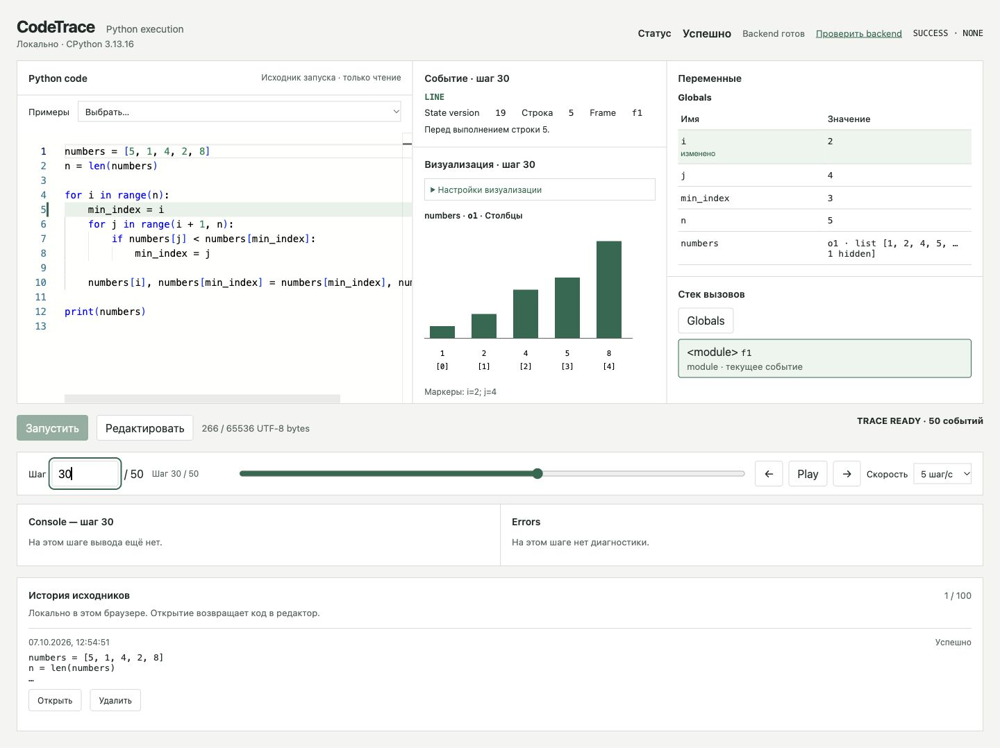
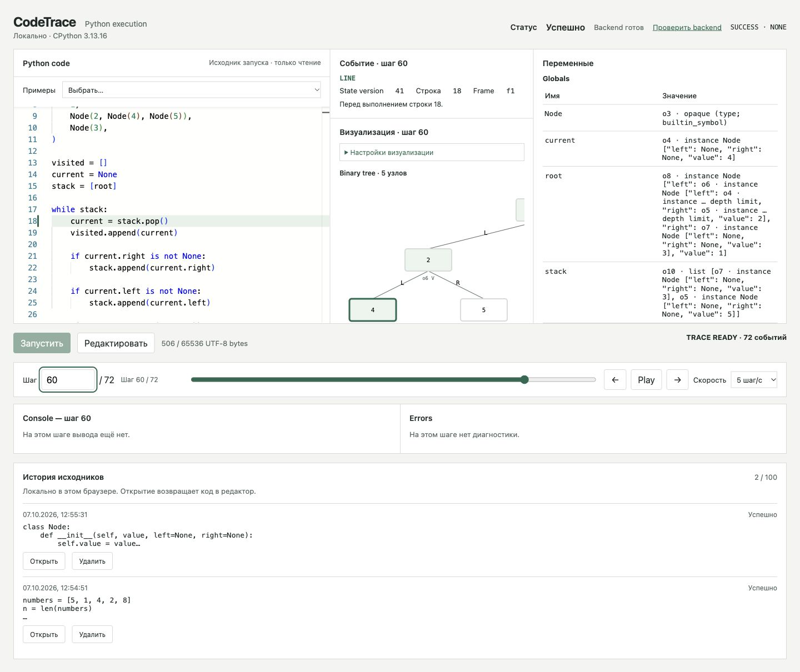
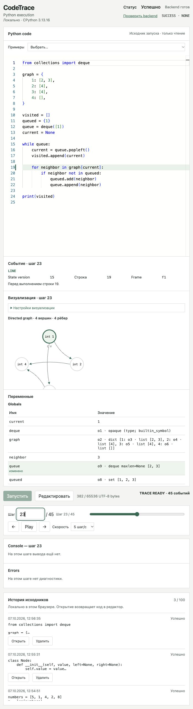
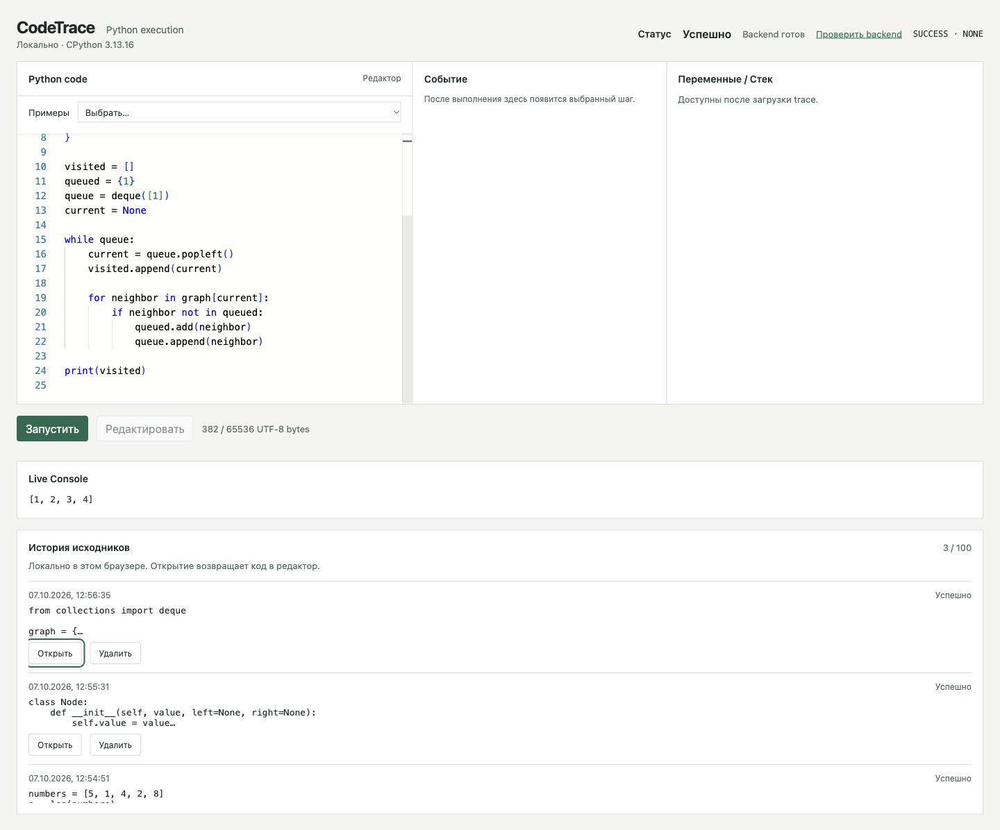
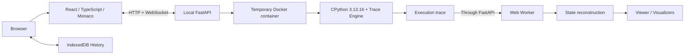

# CodeTrace

_Local interactive Python execution visualizer_

CodeTrace — локальный интерактивный визуализатор выполнения Python-программ.
Я разработал проект для наглядного исследования того, как программа изменяет
своё состояние во время реального выполнения.

CodeTrace действительно запускает введённый код, записывает execution trace,
а интерфейс затем воспроизводит её пошагово. Python выполняется один раз:
Previous, Next и переход к выбранному шагу читают уже записанную трассу.

## Возможности

- Monaco Editor для написания и редактирования Python-кода.
- Реальное выполнение Python с подсветкой текущей строки.
- Previous / Next, Play / Pause, slider и переход на конкретный Step.
- Согласованные Variables, Call Stack и Console на выбранном шаге.
- Интерактивный `input()`: тот же Python-процесс ждёт ответ и продолжает работу.
- Визуализация массивов, бинарных деревьев, графов и стека вызовов.
- Сохранение aliasing, общих и циклических ссылок в состоянии объектов.
- Локальная History в IndexedDB с дедупликацией одинаковых исходников.
- Семь встроенных примеров и детерминированное воспроизведение trace.

## Демонстрация

### Массив и сортировка



### Обход бинарного дерева



### Граф и очередь BFS



### История и редактор



Все изображения — screenshots работающего приложения.

## Как это работает

1. Пользователь вводит source в Monaco и нажимает «Запустить».
2. FastAPI создаёт временный Docker-контейнер с Python Runner.
3. Trace Engine на основе `sys.settrace()` записывает LINE, CALL, RETURN и EXCEPTION
   вместе с состоянием переменных, объектов, кадров и Console.
4. После завершения backend выдаёт готовую trace. Контейнер уже удалён.
5. Один Web Worker загружает trace и восстанавливает состояние выбранного шага.
6. Viewer отображает данные; дальнейшая навигация не обращается к Runner.

LINE фиксируется перед выполнением строки. Одна строка в цикле может породить много
шагов. CALL и RETURN также являются отдельными событиями. Во время `input()`
WebSocket передаёт ответ в тот же процесс; после завершения ввод не повторяется.

## Архитектура



Состояния нормализованы в граф объектов с собственными ObjectId и `$ref`.
Checkpoints и forward deltas позволяют восстанавливать состояние без хранения
полного snapshot для каждого Event. Worker владеет trace; UI получает только
immutable представление выбранного шага. Backend удаляет временный результат
после release или TTL.

Приложение работает локально по **http://127.0.0.1:8000**. Серверной БД,
аккаунтов и облачных сервисов нет. History хранит только исходники и метаданные
запуска: trace и значения input в ней не сохраняются.

### Изоляция исполнения

Каждый запуск выполняется в отдельном временном Docker-контейнере:

- отключённая сеть и non-root UID;
- read-only root filesystem и ограниченный tmpfs;
- лимиты RAM, CPU и PID;
- `cap-drop=ALL` и `no-new-privileges`;
- Docker socket не передаётся внутрь;
- контейнер удаляется после завершения Run.

Это многоуровневая изоляция (defence in depth). Ограничения языка и контейнера
не являются гарантией абсолютной безопасности произвольного враждебного кода.

## Визуализаторы

| Визуализатор | Представление                                                        |
| ------------ | -------------------------------------------------------------------- |
| Array        | Ячейки или столбцы, изменения позиций и явные index markers          |
| Tree         | Бинарное дерево, current / visited; настройка value / left / right   |
| Graph        | Направленный adjacency-list graph, current / visited / queue / stack |
| Call Stack   | Реальные active frames, включая рекурсивные вызовы                   |

Визуализаторы читают записанные данные и явные настройки. Они не пытаются
угадать алгоритм. Неподходящая структура сопровождается объяснением; состояние
программы остаётся доступно в Variables.

## Встроенные примеры

- Цикл
- Изменение списка
- Сортировка
- Функция
- Рекурсивный факториал
- DFS бинарного дерева
- BFS графа

Каждый пример — обычный Python source с настройками представления. Он выполняется
тем же Runner, что и пользовательский код. Выбор примера только вставляет код
в редактор; запуск происходит по кнопке.

## Что я реализовал

В проекте я самостоятельно реализовал архитектуру execution trace / replay,
Python Trace Engine и сериализацию состояния, Docker lifecycle и watchdog,
FastAPI backend и WebSocket transport, React frontend, реконструкцию в Web Worker,
визуализаторы, IndexedDB History, unit, integration и browser tests.

## Технологии

| Слой      | Технологии                                                              |
| --------- | ----------------------------------------------------------------------- |
| Frontend  | React, TypeScript, Vite, Monaco Editor, Web Worker, IndexedDB           |
| Backend   | Python, FastAPI, HTTP, WebSocket                                        |
| Execution | CPython 3.13.16, Docker, `sys.settrace()`                               |
| Проверки  | pytest, Node test runner, React rendering, Docker integration, Chromium |

## Быстрый запуск

### Требования

- CPython **3.13.16**, обычная сборка с GIL, без JIT.
- Node.js **24+**, pnpm **11.19.0**.
- Запущенный Docker Engine / Docker Desktop.

Проверенная платформа — macOS arm64. Linux и Windows отдельно не проверялись.
При установке может требоваться интернет для зависимостей и Docker base image.

### Установка

Выполните из корня репозитория. Каталог `dist/local` до установки должен отсутствовать.

```sh
python3.13 -m venv .venv
.venv/bin/python -m pip install -r requirements.lock
pnpm install --frozen-lockfile
pnpm build
.venv/bin/python -m pip wheel --no-deps --no-build-isolation --wheel-dir dist .
.venv/bin/python backend/scripts/build_runner_image.py
.venv/bin/python scripts/install_local.py dist/local
```

### Запуск

```sh
dist/local/venv/bin/python -I dist/local/run.py
```

### Открыть приложение

Откройте **http://127.0.0.1:8000/**, выберите пример и нажмите «Запустить».
Для завершения backend используйте Ctrl+C. Полная инструкция:
[docs/installation.md](docs/installation.md).

## Поддерживаемый Python

Runner использует CPython 3.13.16. Поддерживаются основные builtin values,
обычные функции, рекурсия, простые classes и `collections.deque`; состояние
сохраняет общие ссылки и циклы. Поддержка языка ограничена:
[docs/supported-python.md](docs/supported-python.md).

## Ограничения

- Ограниченный Python subset и импорты `math` / `collections`.
- Async / await и yield / generators не поддерживаются.
- Пользовательские `exec` / `eval` / `compile` и произвольный `open` недоступны.
- Одновременно допускается один Run.
- По умолчанию: 100 000 Events, 50 MiB trace, 512 MiB RAM и 10 секунд активного
  выполнения. Ожидание input не входит в active timeout, но ограничено отдельно.
- Максимальный размер состояния и максимальное число событий одновременно
  не гарантируются; рисунок ограничен первыми 200 элементами / узлами.
- Старые traces не архивируются. History хранит только source локально.
- Проект ориентирован на локальный запуск; Stop и reconnect к процессу отсутствуют.
- Registry удерживает зарегистрированные объекты до окончания Run, поэтому
  сроки GC / finalizers не эквивалентны обычному выполнению Python.

## Тестирование

Перед подготовкой публичного релиза полный набор проверок включал
**1451 TypeScript/React tests** и **1905 Python tests**. Использовались unit tests,
Docker integration, browser E2E, native IndexedDB, clean-install checks и проверки
resource / timeout limits. Публичный набор не зависит от сохранённых результатов
предыдущих запусков; количество проверок и команды описаны в
[docs/testing.md](docs/testing.md).

```sh
pnpm test
pnpm lint
pnpm typecheck
pnpm format:check
pnpm build
.venv/bin/python -m pytest -q
```

## Структура проекта

```text
backend/    FastAPI, Run Manager, watchdog, Docker Adapter, временная trace
runner/     Python Runner, tracing, serializer, registry, encoder
frontend/   React UI, Trace Core, Worker, visualizers, History, tests
contracts/  JSON schemas, Python / TypeScript DTOs, validators, fixtures
scripts/    Установка и запуск локального bundle
docs/       Документация и screenshots приложения
```

## Документация

- [Установка](docs/installation.md)
- [Поддерживаемый Python](docs/supported-python.md)
- [Формат trace](docs/trace-format.md)
- [Тестирование](docs/testing.md)
- [Architecture Specification v1.0](Architecture_Specification_v1.0.md)
